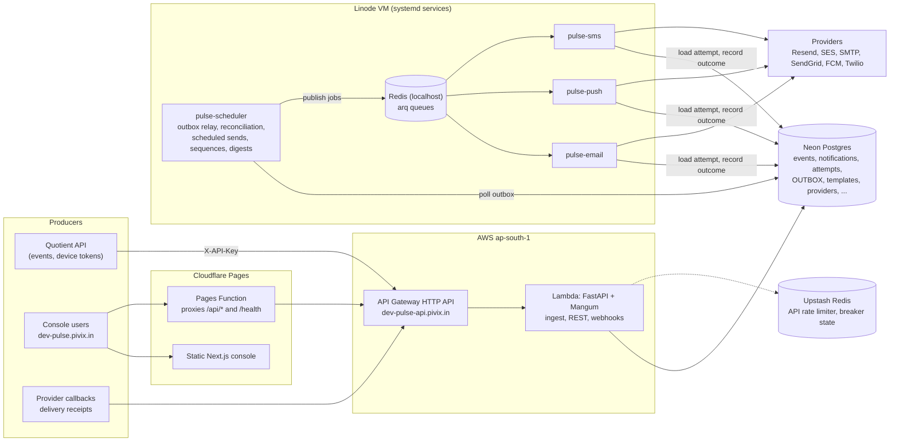
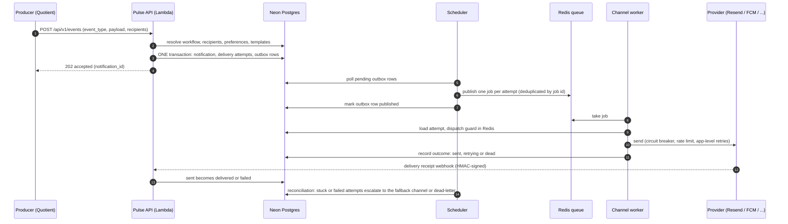
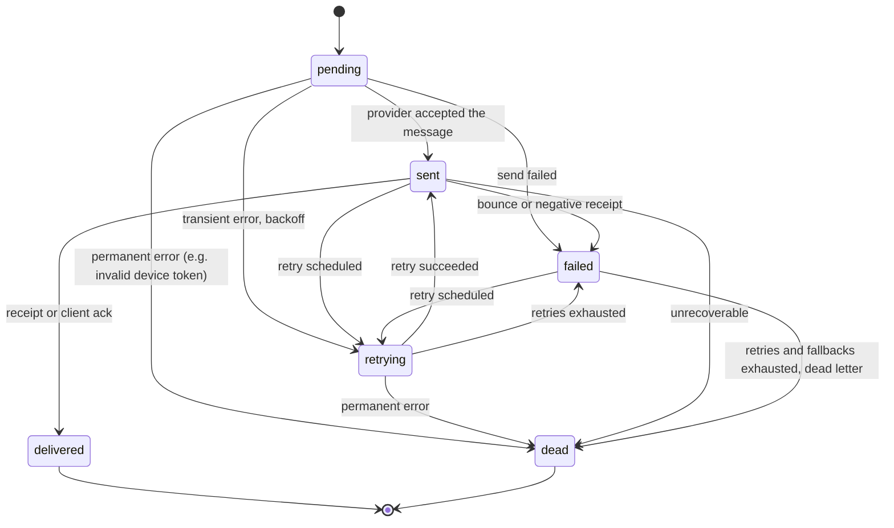
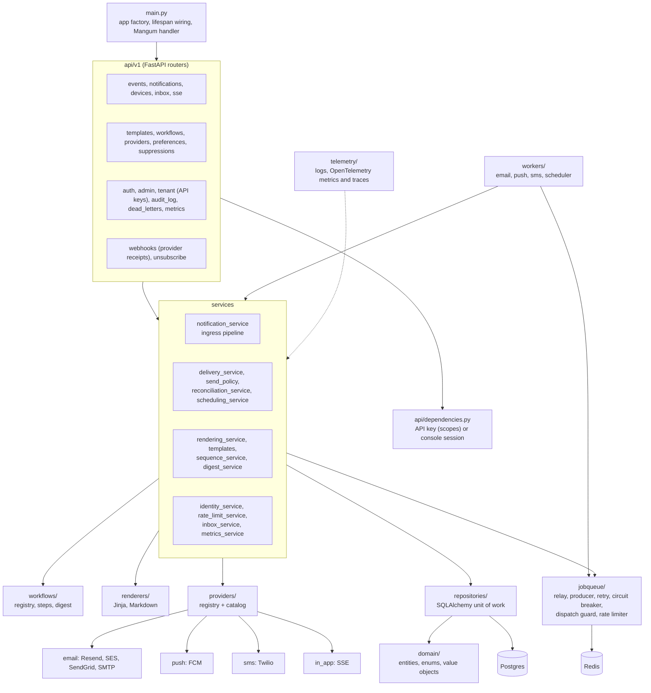
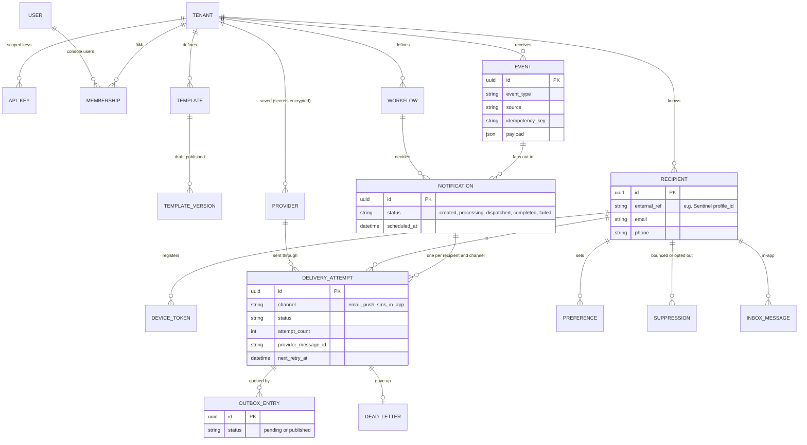

# Pulse

A multi-tenant notification service built with FastAPI. Pulse ingests events, resolves them through workflow definitions and recipient preferences, renders templates, and delivers notifications across email, push, SMS, and in-app (SSE) channels — with an outbox relay, per-channel workers, retries, fallback escalation, and dead-lettering along the way.

## High Level Architecture
```

                                    +----------------------+
                                    |     Sentinel         |
                                    | Users / Tenants      |
                                    +----------+-----------+
                                               |
                                        User & Tenant Lookup
                                               |
                                               |
    +-------------+      Publish Event          +---v-------------------+
    | Quotient    | --------------------------> | Notification API      |
    +-------------+                             | (FastAPI)             |
                                                +-----------+-----------+
                                                            |
                                                 Authentication / Validation
                                                            |
                                                +-----------v-----------+
                                                | Notification Service  |
                                                +-----------+-----------+
                                                            |
                             +------------------------------+------------------------------+
                             |                              |                              |
                     Workflow Resolver             Preference Resolver            Recipient Resolver
                             |                              |                              |
                             +------------------------------+------------------------------+
                                                            |
                                                   Notification Builder
                                                            |
                                                   Render Templates
                                                            |
                                                   Persist Notification
                                                            |
                                              Outbox (same transaction)
                                                            |
                                         Outbox Relay (scheduler process)
                                                            |
                                              Message Queue (arq / Redis)
                                                            |
                            +----------------+---------------+----------------+
                            |                |               |                |
                        Email Worker      Push Worker     SMS Worker     In-App (SSE)
                            |                |               |                |
                        Email Driver     Push Driver     SMS Driver     SSE Broadcaster
                            |                |               |
                        SMTP/Console     FCM/Console     Console
                            |
                        Delivery Status (webhooks / confirmations)
                            |
                    Reconciliation Sweep (fallback escalation, dead letters)
                            |
                    REST API / SSE / Metrics
```

## Deployed architecture



The API (Lambda) only accepts and records work: it writes the notification and an **outbox** row in one transaction and returns
`202`. Everything slow or retryable runs on the long-lived workers on the Linode VM, which Lambda cannot host. Workers and
scheduler use a Redis on the VM itself; the Lambda API uses Upstash only for rate limiting and fails open if it is
unavailable. See [DEPLOYMENT.md](DEPLOYMENT.md).

### Event to delivery



### Delivery attempt states

Each (recipient x channel) leg of a notification is a `DeliveryAttempt` with a strict state machine
(`domain/enums/delivery.py`, `DELIVERY_TRANSITIONS`):



A provider with no receipts (plain SMTP) makes `sent` terminal. Notifications roll up these states into
`created`, `processing`, `dispatched`, `completed` and `failed`.

### Layers



### Data model



Tenants are isolated by `tenant_id` on every table. Recipients are keyed by the producer's own id (`external_ref`), so Pulse
needs no user database of its own.

## Delivery guarantees

- **Transactional outbox** — notifications and their outbox entries are persisted in the same transaction; the relay ([jobqueue/relay.py](jobqueue/relay.py)) publishes at-least-once, deduplicated downstream by job id and a Redis dispatch guard.
- **App-level retries** — the delivery service retries with exponential backoff (`PULSE_RETRY__*`); arq-level retries are disabled.
- **Reconciliation** — [services/reconciliation_service.py](services/reconciliation_service.py) finds attempts stuck in `sent` past a per-channel TTL (or terminally `failed`) and escalates them to the workflow's fallback channel, or dead-letters them. Each channel is tried at most once per notification.
- **Scheduling** — notifications can be scheduled for future dispatch; the scheduler process polls and re-resolves preferences at dispatch time.

## Domain model
### Notification
```
├── Recipient
├── Event
├── Workflow
├── Template
├── Channel
├── Provider
├── DeliveryAttempt
├── Preferences
├── Device
├── OutboxEntry
└── DeadLetter
```

## Directory structure
```
pulse/
├── main.py                  # FastAPI app factory + lifespan wiring
│
├── api/
│   ├── v1/
│   │   ├── events.py        # Event ingress (API-key authenticated)
│   │   ├── notifications.py
│   │   ├── devices.py       # Device token registration
│   │   ├── sse.py           # In-app notification stream
│   │   ├── webhooks.py      # Provider delivery callbacks (HMAC-signed)
│   │   ├── templates.py
│   │   ├── workflows.py
│   │   ├── preferences.py
│   │   ├── providers.py
│   │   ├── metrics.py
│   │   └── schemas.py
│   └── dependencies.py
│
├── config/                  # Pydantic settings, one module per concern
│   ├── settings.py          # Root Settings aggregating the sections below
│   ├── loader.py            # Cached get_settings()
│   ├── app.py / api.py / database.py / redis.py / security.py
│   ├── email.py / push.py / webhook.py
│   └── outbox.py / retry.py / reconciliation.py / logging.py
│
├── domain/
│   ├── entities/            # Notification, DeliveryAttempt, OutboxEntry, DeadLetter, ...
│   ├── value_objects/       # Typed ids, quiet hours
│   └── enums/               # Channel, delivery status, notification status, ...
│
├── services/
│   ├── notification_service.py
│   ├── delivery_service.py
│   ├── rendering_service.py     # Jinja + markdown rendering
│   ├── scheduling_service.py
│   ├── reconciliation_service.py
│   ├── metrics_service.py
│   └── ports/               # Protocols: repositories, providers, publisher, uow, ...
│
├── workflows/
│   └── registry.py          # Workflow definitions (channels, templates, fallbacks)
│
├── providers/
│   ├── email/               # console, smtp
│   ├── push/                # console, firebase (FCM)
│   ├── sms/                 # console
│   ├── in_app/              # SSE
│   ├── webhooks.py          # HMAC signature verification
│   └── registry.py
│
├── renderers/
│   ├── jinja_renderer.py
│   └── markdown_renderer.py
│
├── jobqueue/
│   ├── producer.py          # arq publisher, queue names
│   ├── relay.py             # Outbox relay
│   ├── retry.py
│   └── dispatch_guard.py    # Redis-backed idempotency
│
├── workers/
│   ├── context.py           # Shared arq worker bootstrap
│   ├── email_worker.py
│   ├── push_worker.py
│   ├── sms_worker.py
│   └── scheduler_worker.py  # Outbox relay + reconciliation + scheduled dispatch
│
├── repositories/            # SQLAlchemy repositories + unit of work (uow.py)
│
├── database/
│   ├── models/
│   ├── migrations/          # Alembic
│   └── database.py
│
├── clients/
│   └── sentinel_client.py   # User/tenant lookup (in-memory stub for now)
│
├── sse/
│   ├── registry.py          # Redis-backed connection registry
│   └── broadcaster.py
│
├── telemetry/
│   └── router.py            # Health endpoints
│
└── tests/
```

## In-app inbox

In-app messages are stored per recipient and also pushed live over SSE. Clients list, count, read and archive them
through `/api/v1/inbox`. See [docs/inbox.md](docs/inbox.md).

## Observability

Metrics are exported with OpenTelemetry over OTLP; OpenObserve is the reference backend. See
[docs/observability.md](docs/observability.md) for setup, the metric catalogue and suggested alerts.

## Testing

```bash
make test        # unit + API tests, in-memory fakes, no services needed
make test-pg     # repository contract tests: in-memory fakes vs real Postgres, incl. SKIP LOCKED
make e2e         # smoke + chaos tests: real API, workers and scheduler on real Postgres + Redis
```

Console tests live in [web/](web/): `npm run test:unit` (pure logic) and `npm run test:e2e` (Playwright against a running API and console, using the Chrome you have installed; sign in with the `make seed-admin` account).

`make e2e` starts the compose Postgres and Redis, then runs `tests/e2e`: the full event → outbox → worker → delivery → settlement path, provider failover with the circuit breaker, a worker `SIGKILL`ed mid-send, and a lost queue job. Each run uses a throwaway database and Redis DB index. If port 6380 is taken by another project, use `PULSE_REDIS_PORT=6390 make e2e` with `PULSE_REDIS__PORT=6390` exported.

`tests/repositories` runs each repository assertion against the in-memory fakes and, with `PULSE_PG_TESTS=1`, the real Postgres repositories, so the fakes the rest of the suite relies on stay honest. It also proves the `SKIP LOCKED` queries (outbox relay, stuck-attempt sweep, scheduler) never hand the same row to two workers.

`tests/integration` checks SES events against real SNS signatures with LocalStack (`LOCALSTACK_URL=http://localhost:4566`). CI (`.github/workflows/ci.yml`) runs lint, unit tests and the e2e suite.

## Getting started

Requires Python >= 3.10, [uv](https://docs.astral.sh/uv/), and Docker.

The quickest path is the Makefile:

```bash
make build       # uv sync
make start       # infra + migrations + API + all workers (background, logs in ./logs)
make seed-admin  # bootstrap the first platform admin + tenant (idempotent)
make status      # what's running
make stop        # stop API + workers (infra stays up)
make down        # stop everything including Postgres/Redis
```

`make seed-admin` defaults to `admin@pulse.local` / `admin12345` / tenant "Acme"; override with `make seed-admin email=you@co.com password=… tenant="Your Co"` (or `PULSE_BOOTSTRAP_*` env vars). Change the password after first login.

Run `make help` for the full target list — including per-service foreground targets (`make api`, `make email-worker`, `make scheduler`, …), `make test`, `make lint`, and `make fmt`.

Or manually:

```bash
# Infrastructure (Postgres on :5423, Redis on :6380)
docker compose up -d

# Dependencies
uv sync

# Configuration
cp .env.example .env   # or export PULSE_* vars directly

# Migrations
uv run alembic upgrade head

# API server
uv run uvicorn main:app --reload --port 9000
```

### Admin console

The admin console is a separate Next.js app in [web/](web/) (see [web/README.md](web/README.md)); the API serves no UI. `make web` runs it in development on [http://localhost:3100](http://localhost:3100), and `make start` builds and runs it as a Node service beside the API. It proxies `/api` to the API (`PULSE_API_ORIGIN`), so the two deploy independently. Sign in with a seeded or invited account; a tenant switcher in the top bar picks the tenant you act on. It covers metrics, event ingestion, notification/delivery inspection with client acks, a live SSE stream viewer, the recipient inbox, CRUD for workflows/templates/providers/preferences/devices, and — role-permitting — team membership, API keys, and platform-wide tenant/user administration.

## Identity & multi-tenancy

Pulse separates the **control plane** (who may do what) from the notification **data plane** (which already carries `tenant_id` on every row):

- **Tenants** are customer organizations; deactivating one immediately cuts off its API keys and console access.
- **Users** sign in with email + password (scrypt-hashed, stdlib) and get a revocable, HttpOnly session cookie (7-day expiry, hash stored server-side).
- **Roles**: *platform admins* manage tenants and users across the platform and can act on any tenant; per-tenant *admins* manage members and API keys; *members* operate the console.
- **API keys** authenticate machine ingress (`X-API-Key`). Keys are minted per tenant in the console, stored as SHA-256 hashes, displayed exactly once, and revocable. The env-configured `PULSE_SECURITY__INGRESS_API_KEYS` map still works as a dev/bootstrap fallback.
- **Tenant resolution**: every data-plane endpoint accepts either an API key (machines) or a session cookie plus `X-Tenant-Id` header (console users, checked against membership). The SSE stream accepts the key or session via query/cookie since `EventSource` cannot set headers.
- **Bootstrap**: `make seed-admin` creates the first platform admin and tenant; from there everything is done in the UI (invited users receive a one-time temporary password).

### Workers

Each channel runs as its own arq worker process, plus one scheduler process:

```bash
uv run arq workers.email_worker.WorkerSettings
uv run arq workers.push_worker.WorkerSettings
uv run arq workers.sms_worker.WorkerSettings
uv run python -m workers.scheduler_worker   # outbox relay, reconciliation, scheduled dispatch
```

### Tests

```bash
uv run pytest
```

## Configuration

All settings are environment variables prefixed with `PULSE_`, using `__` as the section delimiter (e.g. `PULSE_DATABASE__HOST`). See [.env.example](.env.example) for the full list. Notable ones:

- `PULSE_SECURITY__INGRESS_API_KEYS` — maps ingress API keys to tenant UUIDs.
- `PULSE_EMAIL__DRIVER` / `PULSE_PUSH__DRIVER` — `console` for local development, `smtp` / `fcm` for real delivery.
- `PULSE_WEBHOOK__SECRETS` — per-provider HMAC secrets for delivery callbacks.
- `PULSE_RECONCILIATION__*_TTL_SECONDS` — per-channel sent→confirmed TTLs before fallback escalation.
